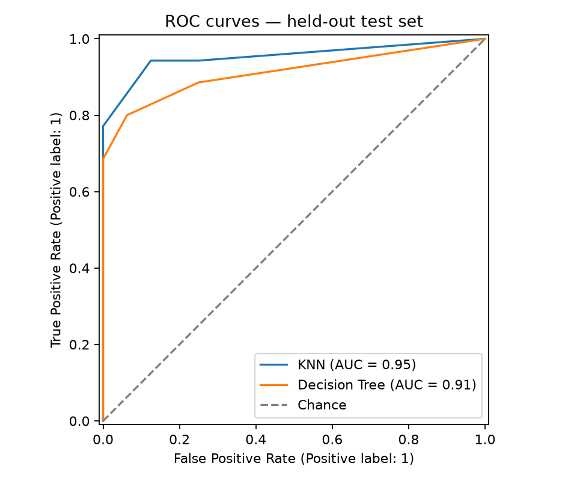
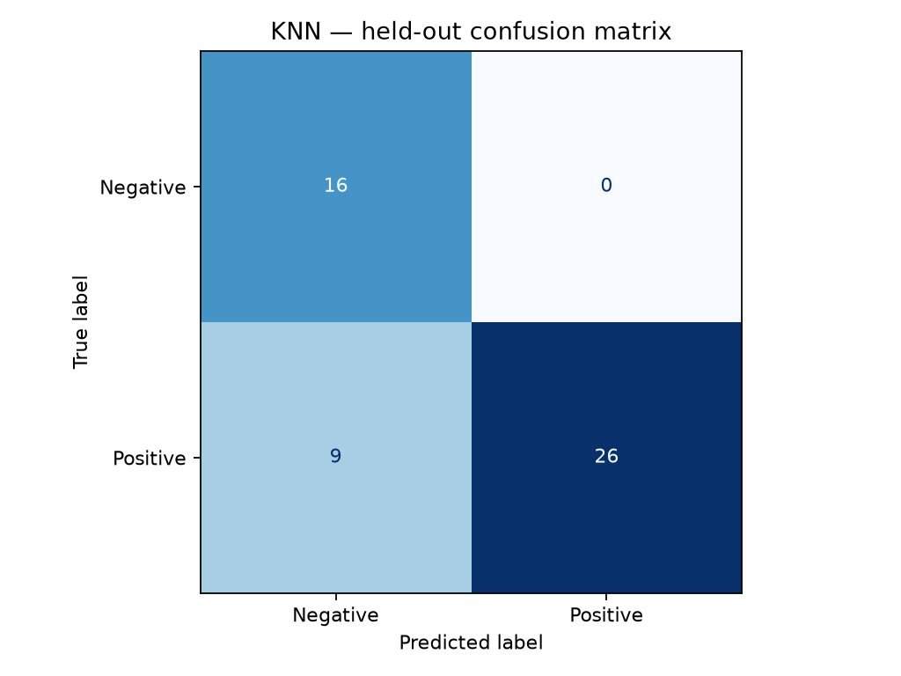
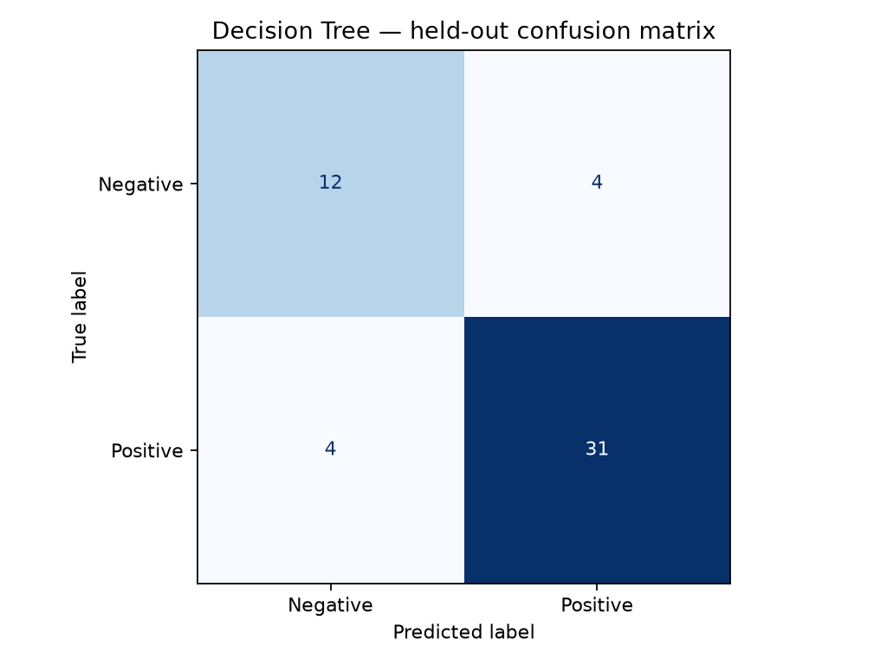

# Diabetes Risk Prediction Using KNN and Decision Tree

A reproducible undergraduate machine learning project that compares **K-Nearest Neighbors (KNN)** and **Decision Tree** classifiers on the **UCI Early Stage Diabetes Risk Prediction** dataset. The project covers data preparation, feature encoding and normalization, hyperparameter tuning, model evaluation, and visualization.

**Project focus:** Machine Learning · Data Preprocessing · Classification · Model Evaluation  
**Tools:** Python, pandas, NumPy, scikit-learn, Matplotlib, pytest  
**Status:** Implemented and evaluated on the original UCI dataset.

> **Research question:** How do KNN and Decision Tree compare on the same held-out dataset when preprocessing and hyperparameter selection are performed using training data only?
>
> **Important:** This is an educational machine learning experiment, **not a clinical diagnostic or medical risk-assessment tool**.

## Dataset

- **Name:** [Early Stage Diabetes Risk Prediction — UCI Machine Learning Repository (ID 529)](https://archive.ics.uci.edu/dataset/529/early+stage+diabetes+risk+prediction+dataset)
- **Original records:** 520
- **Predictor variables:** 16 (age, gender, and questionnaire-based symptoms)
- **Target:** Positive / Negative classification label
- **Dataset DOI:** [10.24432/C5VG8H](https://doi.org/10.24432/C5VG8H)
- **Dataset license:** [CC BY 4.0](https://creativecommons.org/licenses/by/4.0/)

The experiment removes **exact duplicate rows before splitting** the data, leaving **251 unique records** for this run. This is a substantial reduction and is relevant when interpreting the results. The original CSV is downloaded separately and is not committed to this repository.

## Data-quality audit

The source dataset has **520 records**, of which **251 are distinct rows** in the experiment. Run `python -m src.audit` to generate [the data audit](results/data_audit.md), including exact duplicate counts and class distribution. Identical questionnaire rows are not necessarily the same patient, so this is a modeling choice, not proof of participant-level duplication. The audit is generated locally from the downloaded CSV and can be committed alongside the results.

See [the detailed methodology and validity discussion](docs/methodology.md) for a review of preprocessing, evaluation and limitations.

## Methodology

1. **Data validation:** Load the UCI CSV, standardize column names and labels, and remove exact duplicate rows.
2. **Train/test split:** Use an 80/20 stratified split with random seed `42` (**200 training** and **51 held-out test** records after deduplication).
3. **Preprocessing:** Impute missing values, standardize the numeric `age` feature, and one-hot encode categorical features inside scikit-learn pipelines.
4. **Model training:** Tune KNN and Decision Tree separately with `GridSearchCV` and **5-fold stratified cross-validation**, optimizing training-fold F1-score.
5. **Evaluation:** Compare the tuned classifiers on the held-out test set using F1-score, ROC-AUC, balanced accuracy, and other classification metrics.
6. **Model selection:** Select the saved model using **cross-validation F1 on training data**, not test-set performance.

Keeping preprocessing inside the cross-validation pipelines helps avoid leaking validation or test information into model fitting.

## Results

The following results were produced with `python -m src.train` using the downloaded UCI dataset, `random_state=42`, and a single stratified held-out test split.

| Model | Training CV F1 | Test F1 | Test ROC-AUC | Test Balanced Accuracy |
|---|---:|---:|---:|---:|
| KNN | 0.920 | 0.852 | **0.954** | **0.871** |
| Decision Tree | **0.923** | **0.886** | 0.912 | 0.818 |

**Selected model (based on training CV F1): Decision Tree.**

The Decision Tree achieved higher held-out F1, while KNN achieved higher held-out ROC-AUC and balanced accuracy. These are outcomes from one train/test split; they are **not** evidence that either algorithm is universally superior.

### Evaluation figures

**ROC curves — held-out test set**



**KNN — confusion matrix**



**Decision Tree — confusion matrix**



For the generated detailed report and machine-readable results, see [results/report.md](results/report.md), [results/metrics.csv](results/metrics.csv), and [results/metrics.json](results/metrics.json).

## Reproduce the experiment

Run the following commands from the root of the repository.

### Windows (PowerShell)

```powershell
python -m venv .venv
.\.venv\Scripts\python.exe -m pip install -r requirements.txt
.\.venv\Scripts\python.exe scripts\download_data.py
.\.venv\Scripts\python.exe -m src.audit
.\.venv\Scripts\python.exe -m src.train
.\.venv\Scripts\python.exe -m pytest -q
```

The original run was performed with **Python 3.13.14** on Windows. The commands above do not require activating the virtual environment.

### macOS / Linux

```bash
python3 -m venv .venv
source .venv/bin/activate
python -m pip install -r requirements.txt
python scripts/download_data.py
python -m src.audit
python -m src.train
python -m pytest -q
```

If the automatic dataset download fails, download `diabetes_data_upload.csv` from the [UCI dataset page](https://archive.ics.uci.edu/dataset/529/early+stage+diabetes+risk+prediction+dataset) and place it at `data/raw/diabetes_data_upload.csv` before running training.


Training writes the following outputs into `results/`:

- `data_audit.md` and `data_audit.json`: source-data counts, class balance, and duplicate audit
- `metrics.csv` and `metrics.json`: evaluation metrics and experiment details
- `report.md`: generated results summary
- `figures/roc_comparison.png`: ROC comparison
- `figures/knn_confusion_matrix.png`: KNN confusion matrix
- `figures/decision_tree_confusion_matrix.png`: Decision Tree confusion matrix
- `best_model.joblib`: selected fitted model, **excluded from Git**

## Repository structure

```text
.
├── .github/
│   └── workflows/
│       └── tests.yml
├── data/
│   ├── README.md
│   └── raw/                 # downloaded data (not tracked)
├── scripts/
│   └── download_data.py
├── src/
│   ├── __init__.py
│   ├── data.py
│   ├── audit.py
│   ├── modeling.py
│   └── train.py
├── tests/
│   ├── test_data.py
│   ├── test_audit.py
│   └── test_train.py
├── docs/
│   └── methodology.md
├── results/                 # generated metrics, data audit, report, and figures
├── .gitignore
├── LICENSE
├── README.md
└── requirements.txt
```

Automated tests validate data processing, the data-quality audit, and training behavior. A GitHub Actions workflow runs the tests on pushes and pull requests.

## Limitations and responsible use

- The data come from a relatively small, single-site, symptom-based questionnaire dataset and do not represent all patient populations.
- Removing exact duplicates reduces one possible source of train/test overlap but **does not guarantee participant-level independence** or eliminate other dataset biases.
- Performance is estimated from one split with only 51 held-out records; results may vary with different splits or populations.
- The dataset label indicates the questionnaire classification outcome, **not an estimate of future diabetes incidence or a calibrated clinical probability**.
- The system must not be used for diagnosis, treatment decisions, or individual medical advice.

Possible next steps include repeated or nested cross-validation, uncertainty reporting, a careful duplicate/record-independence audit, and external validation on an independent dataset.

## License and attribution

The **source code** is released under the [MIT License](LICENSE). The **dataset** belongs to its original contributors and is available through the UCI Machine Learning Repository under [CC BY 4.0](https://creativecommons.org/licenses/by/4.0/); its license is separate from the code license.

**Dataset citation:** *Early Stage Diabetes Risk Prediction* (2020), UCI Machine Learning Repository, [https://doi.org/10.24432/C5VG8H](https://doi.org/10.24432/C5VG8H).


